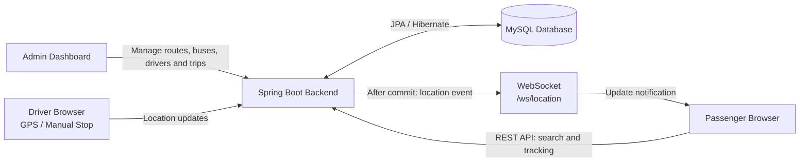
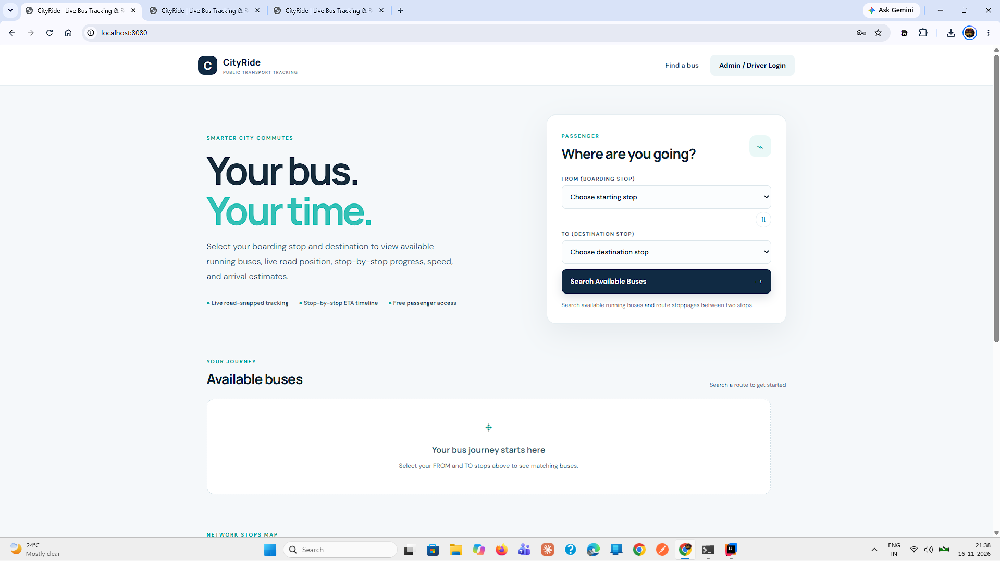
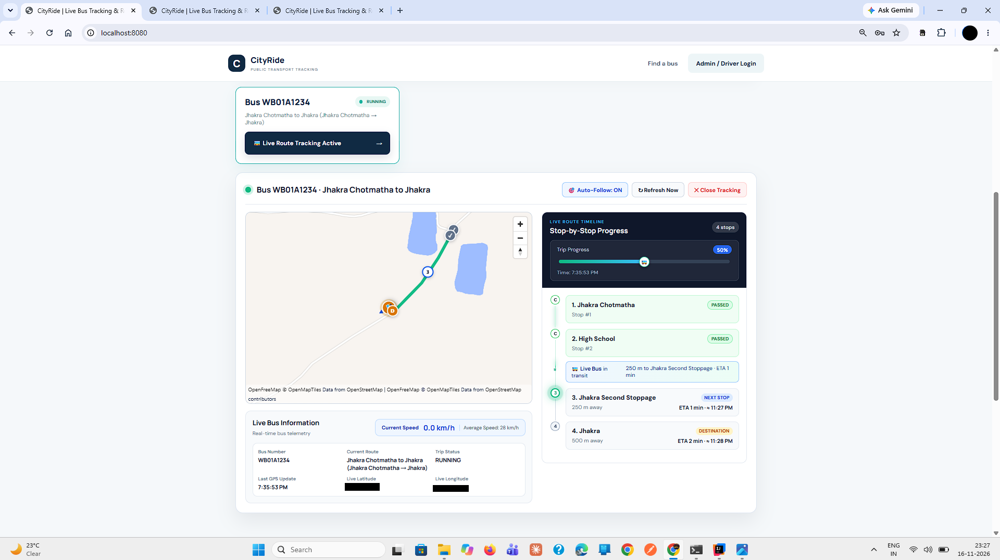
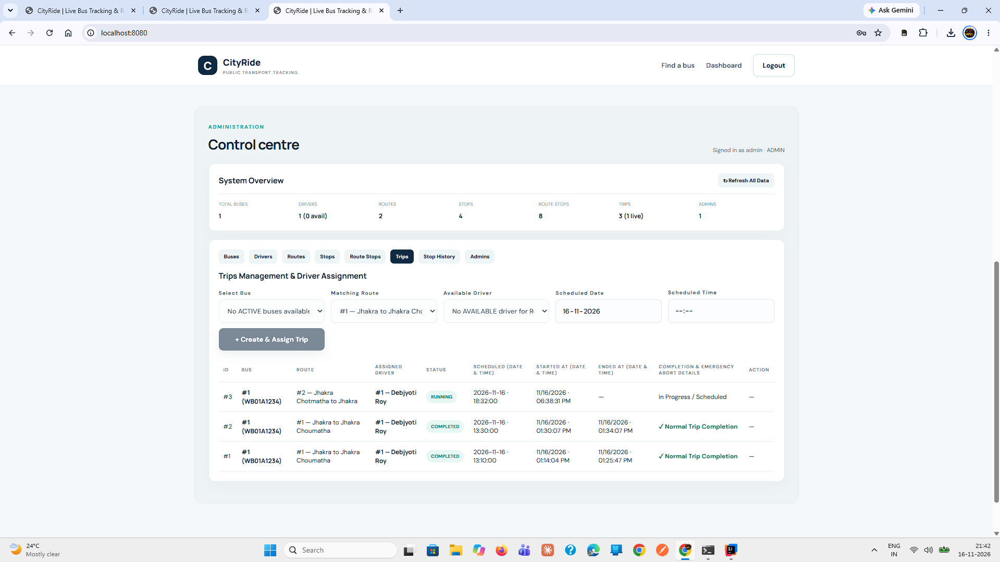
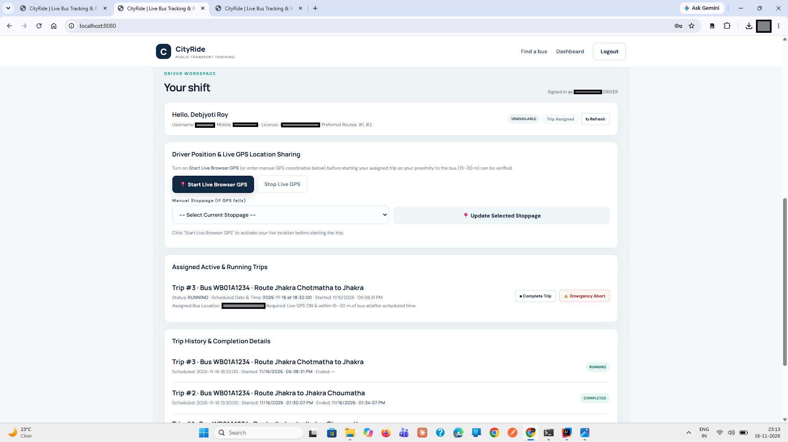

# CityRide – Real-Time Public Bus Tracking System

CityRide is a web application I built to explore how a small-city public bus service could make its daily operations easier and give passengers better information about their journeys.

The main idea is simple: a passenger should be able to check which buses can take them from one stop to another and, when a trip is running, see where the bus is on the route. On the other side, an admin should be able to manage buses, routes, stops, drivers and trips, while a driver should be able to start a trip and share the bus location.

This is an academic and learning project, not a production-ready transport system. I built most of the backend logic by planning the entities, relationships, APIs and service flow myself. I also used ChatGPT and Gemini as supporting tools when I needed help understanding an issue, reviewing an approach, improving code or working through the frontend. The frontend was developed with AI assistance as well, and I reviewed and adjusted it to match the project workflow I wanted.

---

## Contents

- [Why I started this project](#why-i-started-this-project)
- [What the application does](#what-the-application-does)
- [User roles](#user-roles)
- [How the system works](#how-the-system-works)
- [Backend design](#backend-design)
- [How live tracking is handled](#how-live-tracking-is-handled)
- [Technology used](#technology-used)
- [Project structure](#project-structure)
- [API overview](#api-overview)
- [Run the project locally](#run-the-project-locally)
- [How to use the application](#how-to-use-the-application)
- [Screenshots](#screenshots)
- [Current limitations and things to improve](#current-limitations-and-things-to-improve)
- [What I learned](#what-i-learned)

---

## Why I started this project

I wanted to build something that involved **real-time data and actual backend logic**, rather than making another project that only performs basic CRUD operations.

The idea came from a simple question: *Can I build a system where a passenger can search for a bus and follow its movement while the trip is running?*

That question led me to think about the complete flow behind a bus journey:

- How should routes and stops be stored?
- How can the system check whether a bus goes from the selected starting stop to the destination in the correct direction?
- How will the backend know which stop the bus has reached?
- How can it estimate the distance and time to the next stop?
- How should a driver start or finish a trip, and how should the admin manage all of this?

I wanted to work out these rules in the backend myself and understand how the different parts connect. That is why I spent a lot of time on the entities, relationships, service methods, APIs and trip flow.

For the first version, I chose **browser GPS instead of a separate GPS device**. It made the project easier to test without extra hardware. I also added a manual stop option so I could test the journey flow when GPS was not available.

The main learning goal was to understand how a real-time application works behind the screen: how data comes in, how the backend processes it, how the database is updated and how the passenger sees the latest information.

## What the application does

CityRide brings three parts of a bus service into one application:

1. **Passenger side:** Search buses using a starting stop and destination, then open the live tracking view.
2. **Driver side:** View assigned trips, share location and start, complete or abort a trip.
3. **Admin side:** Manage the transport data and assign buses, routes and drivers to trips.

The passenger search is public, so passengers do not need to create an account just to find a bus.

## User roles

### Passenger

- Does not need to log in.
- Selects a `From` stop and a `To` stop.
- Sees buses that match the selected direction.
- Sees the bus route and its scheduled departure time.
- Can open the live tracking view for a selected bus.
- Can view the bus marker, route map, trip progress and stop-by-stop status.

### Driver

- Logs in using a username and the 10-digit mobile number configured for the driver account.
- Can view their profile and assigned trips.
- Can mark themselves available or unavailable.
- Can share their location through browser GPS.
- Can use the manual stop selection option when GPS is not available during testing.
- Can start a trip after the backend checks the required conditions.
- Can complete a trip or submit an emergency abort reason.

### Admin

- Uses the admin login to access the management area.
- Can manage buses, drivers, routes, stops and route-stop order.
- Can set a bus's going route, return route and their departure times.
- Can set up to two preferred routes for a driver.
- Can assign a driver and bus to a trip.
- Can edit an active trip before it starts.
- Can view trip and stop-history information.
- Can create or remove additional admin accounts.

---

## How the system works

The backend is the main place where application rules are handled. The frontend sends requests and displays the returned data. For example, the frontend does not decide whether a driver is close enough to a bus to start a trip; it sends the driver's coordinates, and the backend checks the distance.

A simplified view of the application is shown below. Each part has a separate responsibility, while the Spring Boot backend connects them.



**In short:** the driver sends location data, the backend processes and saves it, and the passenger side refreshes the tracking information to update the map and route timeline.

The passenger tracking screen also makes a periodic API refresh every five seconds. The WebSocket message is used as a signal to refresh the selected bus data; the browser does not treat the WebSocket payload as the complete route timeline.

## Backend design

I kept the backend divided into familiar Spring Boot layers so that each part has a clear responsibility.

| Package | Responsibility |
|---|---|
| `controller` | Receives HTTP requests and returns responses |
| `service` | Contains service interfaces and application operations |
| `service/impl` | Contains the main business logic |
| `entity` | Defines the database entities |
| `repository` | Reads and writes data using Spring Data JPA |
| `dto` | Defines request and response objects used by the API |
| `enums` | Holds bus, driver and trip status values |
| `security` | Contains authentication and request access rules |
| `exception` | Handles application errors in a common way |
| `websocket` | Manages the live location WebSocket connection |

### Main database entities

- **Bus:** Bus number, going and return routes, departure times, current coordinates, speed, bearing and bus status.
- **Driver:** Driver details, username, mobile number, licence information, availability and preferred routes.
- **Route:** Route name and description.
- **Stop:** Stop name and its latitude/longitude.
- **RouteStop:** Connects a route with its stops and stores the stop order. I used this separate entity because a route can contain many stops and the order matters.
- **Trip:** Connects a bus, route and driver for a particular date and scheduled time. It also stores the trip status, start/end time and stop-progress fields.
- **BusStopHistory:** Stores the arrival and departure time for a stop during a particular trip.
- **Admin:** Stores additional admin account information.

### Important backend technologies and why they matter

| Technology / concept | How it is used in CityRide |
|---|---|
| **Spring Boot** | Runs the application and provides the REST API structure. |
| **Spring Data JPA** | Lets the repository layer work with database entities without writing every SQL query manually. |
| **Hibernate (ORM)** | Maps Java entities such as `Bus`, `Route`, `Trip` and `Stop` to MySQL tables, and handles much of the database interaction behind JPA. |
| **MySQL** | Stores the main application data, including route order, trip status and stop history. |
| **DTOs** | Keep API request and response data separate from the database entities. |
| **Spring Security** | Separates public passenger access from protected driver and admin operations using roles. |
| **WebSocket** | Sends a notification when a bus location has been updated, so connected passenger pages can refresh. |
| **Haversine formula** | Calculates the distance between two GPS coordinates. |
| **Maven** | Manages project dependencies and the build process. |

I used **JPA with Hibernate** because the project has several related entities. For example, a trip refers to a bus, a route and a driver, while a route connects to its stops through `RouteStop`. Keeping these relationships in Java entities makes it easier to work with this data in the service layer.

The `RouteStop` entity is important for passenger search and live tracking. A route is not just a list of stop names: the system needs to know the order in which those stops are visited. That order is also used to check whether a bus can travel from the selected `From` stop to the selected `To` stop in the correct direction.

### Why I used DTOs

I use request DTOs to receive the data needed for an operation and response DTOs to return the data needed by the frontend. This keeps the API response separate from the full database entity and gives me more control over what the frontend receives.

### Trip status

The trip flow uses these main statuses:

- `ACTIVE` – the trip has been created and is waiting to start.
- `RUNNING` – the driver has started the trip.
- `COMPLETED` – the trip has ended normally.
- `ABORTED` – the trip was stopped because of an emergency.

Bus and driver availability are tracked separately using their own status fields.

---

## How live tracking is handled

Live tracking is the main part of CityRide. The important work is not only showing a moving bus icon; the backend must understand what each new location means.

### 1. Location comes from the driver

The driver page uses the browser's **Geolocation API** (`navigator.geolocation.watchPosition`) to get location updates. The frontend sends latitude and longitude to the backend.

For testing, the driver can also select a stop manually. This helps me test the trip flow without needing to move a device along a real road.

### 2. Backend calculates movement

The `SpeedCalculationService` handles the main GPS calculations:

- **Haversine formula:** calculates the distance between two latitude/longitude points.
- **Speed calculation:** estimates speed using the distance and time between location updates.
- **Bearing calculation:** estimates the direction of movement, which is used to rotate the bus marker on the map.

These values are estimates based on the location data received from the device.

### 3. Backend checks the next stop

The backend reads the route stops in their `stopOrder`. It checks the next expected stop instead of treating every stop as a separate unrelated location.

The current implementation uses a **60-metre distance threshold**:

- **Arrival:** when the bus comes within 60 metres of the next expected stop, the trip's `pendingStopOrder` is set and an arrival time is recorded.
- **Departure:** when the bus moves at least 60 metres away and the distance from that stop is increasing, the stop is marked as passed. `lastReachedStopOrder` is updated and the departure time is recorded.

The two trip fields have different jobs:

- `lastReachedStopOrder` – the last stop the bus has left/passed.
- `pendingStopOrder` – the stop the bus has reached and has not yet left.

This approach also avoids saving every GPS ping as a separate stop-history record. The history table is used for stop arrival and departure events.

### 4. Database update and WebSocket notification

The backend updates the bus and trip data inside the service transaction. It then registers the WebSocket broadcast to run **after the database transaction commits**.

This matters because the passenger page should be notified after the location update has been saved, rather than while the database transaction is still in progress.

The WebSocket endpoint is:

```text
/ws/location
```

The current WebSocket message acts as a notification. The passenger frontend then requests the latest tracking information through the REST APIs. It also refreshes tracking data every **five seconds**, which provides a fallback if a WebSocket notification is missed.

### 5. Passenger sees the updated journey

The passenger page uses the API response to update:

- Bus position on the map.
- Travelled and remaining route lines.
- Current, passed and upcoming stops.
- Trip progress and estimated time to the next stop.

The current ETA uses an assumed average speed of **28 km/h** with the distance to the next stop. It is a basic estimate, not a traffic-aware prediction.

## Driver trip-start checks

I wanted to avoid allowing a trip to start just because someone clicked the Start Trip button. The backend checks the following:

1. The trip must be in `ACTIVE` status.
2. The bus must be available (`ACTIVE`).
3. The driver must provide a current browser location.
4. The driver's location must be within **30 metres** of the bus's saved coordinates.
5. The current date and time must not be earlier than the trip's scheduled date and time.

If the checks pass, the trip changes to `RUNNING`, the bus changes to `ON_TRIP`, and the start time is saved.

The 30-metre check is based on browser GPS coordinates, so its result can be affected by device accuracy. The current implementation checks that a location is supplied and close enough; it should not be considered a secure proof of physical presence.

---

## Technology used

| Part | Technology | Why I used it |
|---|---|---|
| Backend language | Java 17 | Main language for application logic |
| Backend framework | Spring Boot 4.1.1 | REST APIs and application setup |
| ORM / database access | Spring Data JPA, Hibernate | Mapping Java entities to MySQL tables |
| Database | MySQL 8+ | Stores routes, stops, buses, drivers and trips |
| Security | Spring Security, HTTP Basic | Protects admin and driver API areas |
| Validation | Jakarta Validation | Validates incoming request data |
| Live updates | Spring WebSocket | Sends location update notifications |
| Frontend | HTML5, CSS3, Vanilla JavaScript | Builds the browser interface without a frontend framework |
| Map | MapLibre GL JS | Displays stops, routes and bus movement |
| Map tiles | OpenFreeMap | Provides the map style and tiles |
| Road geometry | OSRM public routing service | Requests road-based route geometry |
| Build tool | Maven | Builds and runs the Spring Boot application |

The map and road-routing features depend on external services and an internet connection. If the routing service does not return road geometry, the frontend has a fallback that connects the stop coordinates directly.

---

## Project structure

```text
RealTimeBusTrackingProject/
└── CityRide/
    ├── pom.xml
    ├── mvnw
    ├── mvnw.cmd
    └── src/
        └── main/
            ├── java/com/bustracking/
            │   ├── BusTrackingApplication.java
            │   ├── controller/
            │   ├── dto/
            │   ├── entity/
            │   ├── enums/
            │   ├── exception/
            │   ├── repository/
            │   ├── security/
            │   ├── service/
            │   │   └── impl/
            │   └── websocket/
            └── resources/
                ├── application.properties
                └── static/
                    ├── index.html
                    └── assets/
                        ├── app.js
                        └── styles.css
```

The frontend is served by Spring Boot from `src/main/resources/static`, so the same application serves the HTML, CSS and JavaScript as well as the backend APIs.

---

## API overview

The following is a grouped overview of the endpoints found in the current source code. All endpoints use the `/api` base path.

### Public / passenger

| Method | Endpoint | Purpose |
|---|---|---|
| `GET` | `/api/stops` | Get the registered stops |
| `GET` | `/api/passenger/buses?from={from}&to={to}` | Search buses for a journey |
| `GET` | `/api/passenger/tracking/{busId}?routeId={routeId}` | Get live bus tracking information |
| `GET` | `/api/passenger/routes/{routeId}/stops` | Get stops in route order |
| `GET` | `/api/buses/{id}/details?routeId={routeId}` | Get stop status and ETA details |
| `GET` | `/api/route-stops/search?...` | Search route-stop information |
| `WS` | `/ws/location` | Receive bus location notifications |

`routeId` is optional on the tracking and bus-details requests where supported by the controller. The frontend passes it when a bus search result identifies the selected route.

### Authentication

| Method | Endpoint | Purpose |
|---|---|---|
| `GET` | `/api/auth/me` | Get the signed-in username and role |

### Driver

| Method | Endpoint | Purpose |
|---|---|---|
| `GET` | `/api/driver/me` | Get the logged-in driver's profile |
| `PATCH` | `/api/driver/status` | Update driver availability |
| `GET` | `/api/driver/trips` | Get trips assigned to the driver |
| `PUT` | `/api/driver/trips/{tripId}/start` | Start an assigned trip |
| `PUT` | `/api/driver/trips/{tripId}/complete` | Complete a running trip |
| `PUT` | `/api/driver/trips/{tripId}/abort` | Abort a trip with a reason |
| `PUT` | `/api/driver/location` | Send the driver's location for the running trip |

### Admin management

The admin endpoints are grouped by resource:

| Resource | Base endpoint | Available operations |
|---|---|---|
| Admin accounts | `/api/admin/accounts` | List, create and delete accounts |
| Buses | `/api/buses` | Create, list, view, update, update location and delete |
| Drivers | `/api/drivers` | Create, list, view, update, change status, set preferred routes and delete |
| Routes | `/api/routes` | Create, list, view, update and delete |
| Stops | `/api/stops` | Create, list, view, update and delete |
| Route stops | `/api/route-stops` | Create, list, view, update, search and delete |
| Trips | `/api/trips` | Create, list, view, update and delete |
| Stop history | `/api/bus-stop-history` | List, view and delete history records |

The exact request fields are defined by the DTOs in the `dto` package. The endpoint list is an overview, not a replacement for checking the controller and DTO code when integrating another client.

---

## Run the project locally

### Requirements

- Java JDK 17 or later
- MySQL 8 or later
- Maven (or the Maven wrapper included in the project)
- A modern browser
- Internet access for the external map tiles and OSRM road geometry

### 1. Create the database

Open MySQL Workbench or the MySQL command line and run:

```sql
CREATE DATABASE IF NOT EXISTS bustracking;
```

### 2. Configure the database connection

Open:

```text
src/main/resources/application.properties
```

The current local defaults are:

```properties
spring.datasource.url=${DB_URL:jdbc:mysql://localhost:3306/DATABASE_NAME}
spring.datasource.username=${DB_USERNAME: DATABASE_USERNAME}
spring.datasource.password=${DB_PASSWORD: DATABASE_PASSWORD}

spring.jpa.hibernate.ddl-auto=update

app.security.admin.username=${ADMIN_USERNAME:admin}
app.security.admin.password=${ADMIN_PASSWORD:admin123}
```

Change the database username and password to match your local MySQL setup. You can also provide the environment variables shown above instead of editing the defaults.

**Important:** These are development defaults, not safe production credentials. Do not publish real passwords or use these defaults on a public server.

### 3. Run the application

Open a terminal in the `CityRide` folder (the folder that contains `pom.xml`) and run:

**Windows:**

```bash
mvnw.cmd spring-boot:run
```

If Maven is installed globally, this also works:

```bash
mvn spring-boot:run
```

**Linux / macOS:**

```bash
./mvnw spring-boot:run
```

### 4. Open the application

Visit:

```text
http://localhost:8080
```

The passenger interface is available without logging in. Use the staff login area to access the admin or driver side.


### 5. Test driver GPS from another device using ngrok

One important issue I faced while testing CityRide was sending the driver's live location from a phone or another device.

The Driver Panel uses the browser's **Geolocation API** (`navigator.geolocation.watchPosition`) to read the device's current latitude and longitude. Modern browsers normally allow location access only in a **secure context**, which means an HTTPS website (or `localhost` on the same computer). When I opened the application from another device using a local network address such as `http://192.168.x.x:8080`, the browser could block location access because that address was using HTTP instead of HTTPS.

I use **ngrok** during development to solve this testing problem. ngrok creates a temporary public HTTPS address and forwards requests from that address to the Spring Boot application running on my computer.

#### What is ngrok, and why did I use it?

ngrok creates a secure public HTTPS address that forwards requests to an application running on my own computer. In this project:

- Spring Boot continues running locally on port `8080`.
- ngrok gives me a temporary HTTPS forwarding URL.
- I open that HTTPS URL on the phone (Allow also another device).
- The phone's browser can then request location permission because the page is served over HTTPS.
- Requests received by ngrok are forwarded to my local Spring Boot application.

ngrok does **not** calculate GPS coordinates and does not replace the backend. It only provides a secure route from the other device to the application running on my computer. The browser gets the GPS coordinates, and CityRide's existing driver API processes them.

#### One-time ngrok setup

1. Create an account on [ngrok](https://ngrok.com/).
2. Download and install ngrok for Windows.
3. Sign in to the ngrok dashboard and copy your personal **Authtoken**.
4. Open Command Prompt or PowerShell and connect your ngrok installation to your account:

```bash
ngrok config add-authtoken YOUR_NGROK_AUTHTOKEN
```

Replace `YOUR_NGROK_AUTHTOKEN` with the token shown in your ngrok dashboard. Run this setup command only on your own computer. **Do not paste the token into this README, GitHub, screenshots, Postman requests or public messages.**

#### Start the application and create the HTTPS link

Keep the Spring Boot application running first.

**Terminal 1 – Start CityRide:**

```bash
cd path\to\RealTimeBusTrackingProject\CityRide
mvnw.cmd spring-boot:run
```

Wait until Spring Boot has started successfully. The application should be available on:

```text
http://localhost:8080
```

**Terminal 2 – Start ngrok:**

Open a second terminal and run:

```bash
ngrok http 8080
```

ngrok will display a forwarding address similar to:

```text
Forwarding  https://example-name.ngrok-free.app -> http://localhost:8080
```

The actual address will be different. Copy the **HTTPS** address shown by your own ngrok terminal. Do not use the example address above.

#### Open CityRide on the phone and send live location

1. Keep both terminals open: the Spring Boot terminal and the ngrok terminal.
2. Connect the phone and computer to the internet.
3. Open the HTTPS forwarding address(Copy the HTTPS URL (e.g., https://example-name.ngrok-free.app) displayed in the ngrok terminal) from ngrok on the phone.
4. Sign in to the `Driver Panel` using the driver's configured username and mobile number.
5. Allow the browser's location permission when prompted. If permission was previously blocked, change the site permission to **Allow location** and reload the page.
6. Open the assigned trip, start live browser GPS and complete the normal trip-start checks.
7. Keep the Driver Panel open and location sharing active while testing. The phone sends its browser GPS updates to the local Spring Boot backend through ngrok.
8. Open the passenger page using the same HTTPS address (or another browser/device) to check the bus tracking updates.

**Important:** The ngrok terminal must remain running during the test. If you stop ngrok, close its terminal or lose the tunnel, the HTTPS address will stop forwarding to your computer. A temporary ngrok address can also change when a new tunnel is started, so use the latest address displayed in the terminal.

#### Why the normal local link did not work on the phone

| Address used | What it means | Browser GPS behaviour |
|---|---|---|
| `http://localhost:8080` on the development computer | The application is opened on the same computer | Usually allowed because localhost is treated as a secure context |
| `http://192.168.x.x:8080` on a phone | The phone opens the computer through a local-network HTTP address | Browser may block Geolocation because this is not a secure context |
| `https://your-ngrok-address` on a phone | The phone opens the HTTPS tunnel created by ngrok | Allows the browser to request GPS permission, subject to user permission and device settings |

This is why I used ngrok for phone-based GPS testing. The issue was not that the Driver Panel had no location API; the browser's secure-context rule prevented the phone from sharing its location through the plain HTTP local-network address.

#### What happens to WebSocket when using ngrok?

CityRide also uses WebSocket at `/ws/location` to notify passenger pages about bus location updates. The frontend builds the WebSocket address from the page's current host:

- When the page is opened over HTTP, it uses `ws://`.
- When the page is opened over HTTPS, it uses `wss://`.

So, when the phone opens CityRide using the ngrok HTTPS address, the frontend uses the secure WebSocket connection (`wss://`) on the same ngrok host. The project's `application.properties` already includes ngrok HTTPS origin patterns in `app.websocket.allowed-origin-patterns` for this development testing setup.

#### Notes and safety

- ngrok is a development/testing tunnel, not the production hosting solution for CityRide.
- Anyone who gets the temporary public URL may be able to reach the application. Admin and driver operations still depend on the application's authentication and authorization rules, but public passenger endpoints remain public.
- Do not share the URL unnecessarily while the application is running.
- Do not expose your ngrok Authtoken or database credentials.
- Use a fresh tunnel URL if the old temporary URL stops working.
- For a real deployment, host the application behind a properly configured HTTPS domain with suitable security controls instead of depending on a temporary ngrok tunnel.

### 6. Checking APIs with Postman

I used **Postman** to test the backend APIs separately from the browser interface. Postman is an API testing tool: it lets me send HTTP requests to Spring Boot and inspect the response. It helps check whether an endpoint and its backend logic are working before I test the same operation through the Driver, Admin or Passenger screen.

Postman is not required to run CityRide, and it does not provide the driver's GPS. The browser's Geolocation API provides the coordinates; Postman is used to test API behaviour manually.

For local testing, use this base URL:

```text
http://localhost:8080
```

For a test through ngrok, use the current HTTPS forwarding address shown in the ngrok terminal as the base URL.

Examples of APIs that can be checked in Postman:

| What I want to test | Method and endpoint |
|---|---|
| Check the public list of stops | `GET /api/stops` |
| Search buses between two stops | `GET /api/passenger/buses?from={from}&to={to}` |
| Check passenger tracking data | `GET /api/passenger/tracking/{busId}?routeId={routeId}` |
| Check the driver's profile | `GET /api/driver/me` |
| Check trips assigned to the driver | `GET /api/driver/trips` |
| Send a driver location update | `PUT /api/driver/location` |
| Check the signed-in user's role | `GET /api/auth/me` |

For protected driver or admin APIs, send the required authentication details in Postman's **Authorization** tab using the authentication method configured by the application. For requests with a body, choose **Body → raw → JSON** and use the exact fields required by the corresponding request DTO in the `dto` package. The required request body can vary by endpoint, so check its DTO and controller instead of copying an unrelated JSON example.

A useful testing order is:

1. Test a public GET endpoint such as `GET /api/stops`.
2. Test driver login/authentication and confirm the driver role.
3. Fetch the driver's assigned trips.
4. Test the location update endpoint with the correct driver authentication and the request fields defined by its DTO.
5. Check the passenger tracking endpoint to confirm that the backend returns the updated bus information.
6. Finally, test the same complete flow from the actual Driver Panel and Passenger Panel using the ngrok HTTPS link.

If an API works in Postman but the Driver Panel does not send GPS from a phone, check the browser's HTTPS/secure-context requirement and location permission. Postman does not enforce browser GPS permissions, so a successful Postman request alone does not prove that the phone browser can access its GPS.

**Postman collection note:** No Postman collection file was included with the README supplied for this update. The endpoint list above is a manual testing guide; it does not claim that a collection has been exported or attached.

### Local login notes

- Default development admin username: `admin`
- Default development admin password: `Admin@12345`
- Driver login: the driver's configured username and 10-digit mobile number
- Additional admin login: the configured username and mobile number

The current authentication provider compares the configured credentials directly. The mobile-number-as-password approach is only a simple project/demo arrangement. It should be replaced with proper password setup, password hashing and account recovery before any real deployment.

---

## How to use the application

The suggested order is to add the base transport data first, then assign a trip.

### 1. Set up the system as Admin

1. Sign in using the admin development account.
2. Open the **Stops** section and add the stops. Enter the stop name and its latitude and longitude.
3. Open **Routes** and create the required routes.
4. Open **Route Stops** and connect the stops to each route in the correct order. For example, the first stop should have order `1`, the next stop `2`, and so on.
5. Open **Buses** and add a bus. Set its going route and departure time, as well as its return route and return departure time.
6. Open **Drivers** and create driver accounts. Add the driver's username and mobile number, then set their preferred routes and availability.
7. Open **Trips** and assign a bus, route, driver, date and scheduled departure time.

The route-stop order matters. Passenger search checks that the selected destination comes after the selected starting stop on the same route.

### 2. Start and operate a trip as Driver

1. Sign in with the driver's username and configured mobile number.
2. Open the assigned trips section.
3. Allow browser location access and start live GPS.
4. When the driver is near the assigned bus and the scheduled date/time condition is satisfied, select **Start Trip**.
5. Keep location sharing active while the bus is moving.
6. If GPS is not available during a local test, use the manual stop option to simulate movement through the route.
7. Select **Complete Trip** at the end of a normal trip. Use **Emergency Abort** only when the trip needs to be stopped unexpectedly and provide a reason.

### 3. Search and track as Passenger

1. Open the application without signing in.
2. Select the starting stop and destination.
3. Click the bus search action.
4. Review the matching buses, route names and departure times.
5. Select a bus and open its live tracking view.
6. Follow the bus marker on the map and check the route timeline for passed, current and upcoming stops.

For meaningful live tracking, the admin should have created the route and its ordered stops, and a trip should have been started by a driver.

---

## Screenshots
### 1. Passenger – Search buses



### 2. Passenger – Live bus tracking



### 3. Admin dashboard


### 4. Driver dashboard



### 5. Database or architecture diagram (optional)


### 6. Project Demo Video 

[▶ Watch on YouTube](https://youtu.be/91f3LIod6gA?si=IUsXN0tQUWDqwcKb)
## Current limitations and things to improve

CityRide is a learning project and a working demonstration of the main flow. It has not been tested or prepared for a real public transport deployment.

The main things I would improve next are:

1. **GPS accuracy:** Browser GPS can drift or lose accuracy. A real service should use reliable vehicle GPS hardware or a dedicated driver app.
2. **Stop detection:** The current 60-metre rule is simple and can be affected by traffic, GPS noise or nearby stops. It needs more real-route testing and stronger edge-case handling.
3. **ETA accuracy:** The current ETA uses an assumed average speed. Live traffic, road closures and historical travel times are not included.
4. **Authentication:** The demo uses a mobile number as the driver/admin password in some login flows. This should be replaced with proper password setup, secure password hashing and account recovery.
5. **Deployment and scale:** The WebSocket sessions are held in application memory, and the project has not been load-tested for many buses or passengers. A larger deployment would need a shared messaging setup and performance testing.
6. **Production operations:** Database migrations, backups, HTTPS, stronger access controls, logging, monitoring and automated tests still need more work.
7. **External map services:** Map tiles and road geometry depend on external services and an internet connection, so their availability and usage limits need to be considered.

These are the main areas I would focus on before using the system beyond a local demonstration.

## What I learned

While working on CityRide, I got practical experience with:

- Designing entities and relationships for a system with buses, drivers, routes, stops and trips.
- Using `RouteStop` as a separate entity to preserve the order of stops.
- Separating controllers, services, repositories, entities and DTOs in a Spring Boot project.
- Writing REST APIs and handling request validation and application exceptions.
- Using Spring Security to separate public passenger access from admin and driver operations.
- Working with latitude/longitude, the Haversine formula, speed estimates and bearing.
- Thinking through trip states and how a bus moves from one stop to the next.
- Using WebSocket notifications alongside normal REST requests.
- Connecting a browser frontend to backend APIs and displaying data on an interactive map.
- Debugging issues that appear when several parts of an application depend on one another.

One of the biggest lessons was that live tracking is not just about moving a marker on a map. The backend has to decide what a location update means: whether the bus is approaching a stop, has reached it, has left it, or whether the GPS reading is simply inaccurate.

## A note about development and AI assistance

I planned the main project flow and worked through most of the backend structure and business rules myself. I used `ChatGPT` and `Gemini`, `Github Copilot`, `Claude` when I needed help understanding a concept, debugging an issue, comparing approaches or reviewing a piece of code. I also took more help from AI while building the frontend layout and browser-side interactions.

I still had to check the suggestions, connect the pieces and test whether the application behaved the way I intended. I see these tools as development support; the project is also where I practised making technical decisions and understanding the backend logic.

---

## Author

**Debjyoti Roy**  
B.Tech – Information Technology  
Expected Graduation: 2027

**Project:** CityRide – Real-Time Public Bus Tracking System
